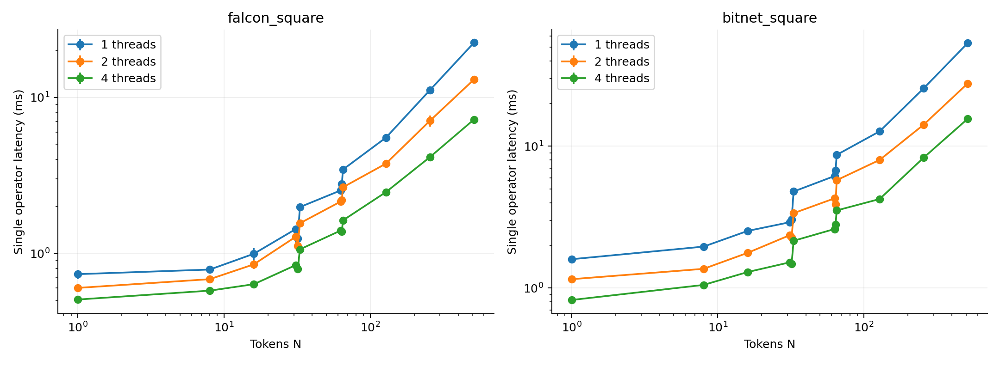
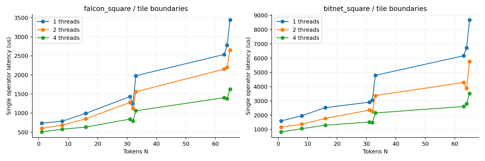
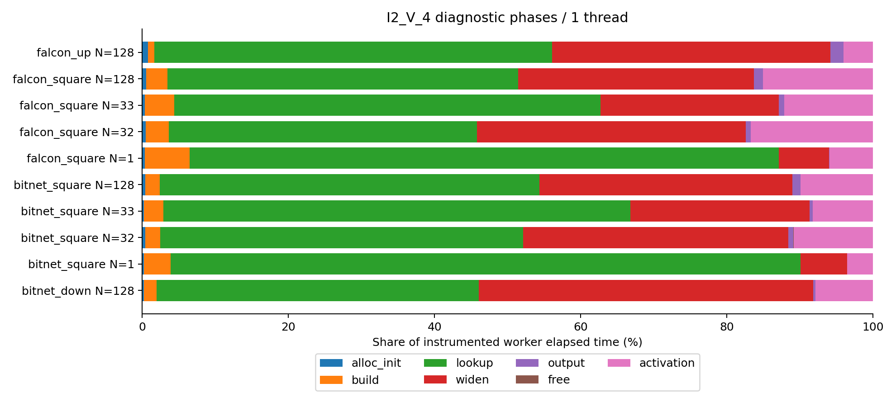
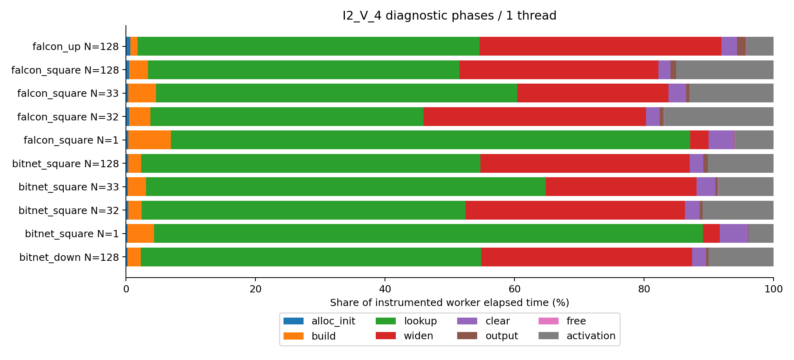

# P2：I2_V_4 内核性能与瓶颈分析

日期：2026-11-17。本报告为本机实测，作者原版保留；没有其他框架对比，没有 GGUF 下载或整模型推理。

正式运行：`p2-20261117-202258-436`；代码 SHA：`438ea26d01e47d495342976eea1c3d8fad93dbb4`。
构建与方法见 [P2_METHOD.md](P2_METHOD.md)，原始数据见 [evidence/p2](evidence/p2)。

## 1. 测量范围和质量

i7-12700H / WSL2 Ubuntu 24.04 / GCC 13.3；Release、AVX2 native、tile=32、weight unroll=16、累加块 K=128。OpenMP 被固定到虚拟 CPU places `{0},{2},{4},{6}`，不推断宿主物理核映射。

六种模型层形状、12 个 N、graph 线程 1/2/4，以及预量化输入的 direct 单线程。全部使用合成三值权重和确定性激活。单算子包括内部临时分配；graph 另包括量化、重排与同步。

正式配置 288 组、原始样本 1440 个，每组 5 次；其中 CV>10% 的配置 8 组。主线程采样前后迁移 0 次，计时区间 major faults=0，WSL swap in/out=0/0 页。最低可用内存约 10.70 GiB。

进程峰值 RSS 最高 194.9 MiB，包含参考计算保留的浮点权重，不能当成真实模型/纯内核内存。

normal/profile 两个库均有 P1 的 164 项、5 个非法输入拒绝和大工作区运行证据；新矩阵计时前后各检查抽样输出。所有用例完成并不等于全模型正确性或精度验收。高波动配置只用于观察数量级，不能支持几个百分点的收益。

## 2. 未插桩性能

下表为 graph 单次矩阵运算中位数，单位 ms；括号内为 CV。1→4 加速是同系统不同线程数的比值，并非微优化收益。

| 形状 | N | 1 线程 ms (CV) | 2 线程 ms (CV) | 4 线程 ms (CV) | 1→4 比值 |
|---|---:|---:|---:|---:|---:|
| falcon_square | 1 | 0.736 (10.4%) | 0.601 (4.4%) | 0.506 (3.8%) | 1.45× |
| falcon_square | 32 | 1.244 (9.1%) | 1.120 (6.7%) | 0.795 (3.9%) | 1.56× |
| falcon_square | 128 | 5.520 (3.0%) | 3.761 (7.7%) | 2.470 (7.3%) | 2.23× |
| falcon_square | 512 | 22.414 (3.1%) | 13.019 (1.6%) | 7.214 (11.4%) | 3.11× |
| bitnet_square | 1 | 1.598 (4.2%) | 1.156 (3.2%) | 0.824 (3.8%) | 1.94× |
| bitnet_square | 32 | 3.055 (3.6%) | 2.268 (1.8%) | 1.486 (3.6%) | 2.06× |
| bitnet_square | 128 | 12.742 (3.6%) | 8.013 (7.1%) | 4.247 (8.1%) | 3.00× |
| bitnet_square | 512 | 53.386 (1.7%) | 27.714 (4.4%) | 15.614 (1.5%) | 3.42× |

完整 FFN 升/降维及其他 N 见 summary.csv，不只展示表现好的形状。runs/s=1e6/µs，不能换名为整模型 tokens/s。

误差线为中位数 ± IQR/2，不是置信区间。

## 3. 尾块与短输入

固定宽度 32 的 LUT：N=1 仍建表并查询 32 个 lane；N=33 需要第二个 tile，其中 31 个 lane 无效。对应有效 lane 比例为 1/32=3.125%、33/64=51.56%；但最终 INT32 转置累加只遍历有效 token，所以总时延不会严格按 padded N 成比例。

| 形状 | 线程 | N33/N32 耗时比 | N65/N64 耗时比 |
|---|---:|---:|---:|
| falcon_square | 1 | 1.59× | 1.24× |
| falcon_square | 2 | 1.39× | 1.21× |
| falcon_square | 4 | 1.33× | 1.18× |
| bitnet_square | 1 | 1.57× | 1.29× |
| bitnet_square | 2 | 1.49× | 1.48× |
| bitnet_square | 4 | 1.45× | 1.26× |

这是大形状变化下的成本台阶；不能据此声称新增内核一定能获得相同比例收益，仍需计入新布局、分发和向量化成本。

## 4. 软件分段诊断

下表采用独立 profile 构建的单线程 graph，数字是各阶段中位数归一化后的百分比。它是带插桩的线程经过时间份额，受计时开销及抢占影响，不是硬件性能计数；正式性能以上节 normal 为准。

| 案例 | N | 分配初始化 | 建表 | 查询加法 | 提升/转置/清零 | 输出 | 释放 | 激活转换 |
|---|---:|---:|---:|---:|---:|---:|---:|---:|
| bitnet_down | 128 | 0.2% | 1.8% | 44.1% | 45.7% | 0.3% | 0.0% | 7.9% |
| bitnet_square | 1 | 0.2% | 3.7% | 86.2% | 6.3% | 0.0% | 0.0% | 3.5% |
| bitnet_square | 32 | 0.4% | 2.1% | 49.7% | 36.2% | 0.7% | 0.0% | 10.9% |
| bitnet_square | 33 | 0.3% | 2.6% | 63.9% | 24.5% | 0.4% | 0.0% | 8.3% |
| bitnet_square | 128 | 0.4% | 1.9% | 52.0% | 34.6% | 1.1% | 0.0% | 9.9% |
| falcon_square | 1 | 0.3% | 6.1% | 80.6% | 6.9% | 0.1% | 0.0% | 5.9% |
| falcon_square | 32 | 0.5% | 3.1% | 42.1% | 36.8% | 0.7% | 0.0% | 16.7% |
| falcon_square | 33 | 0.3% | 4.1% | 58.3% | 24.3% | 0.7% | 0.0% | 12.1% |
| falcon_square | 128 | 0.5% | 3.0% | 48.0% | 32.2% | 1.2% | 0.0% | 15.1% |
| falcon_up | 128 | 0.8% | 0.9% | 54.4% | 38.1% | 1.8% | 0.0% | 4.0% |

同案例 profile/normal 单线程中位时延比范围 0.93–1.28，中位 1.09。这同时受分开运行时的环境变化影响，不能把差值全归因于插桩。多线程阶段之和不等于总墙钟或关键路径。

### 从代码解释开销

1. **查表加法是主工作。** `ADD_TABLE_ENTRIES_BLOCK4` 每个输出行取四个索引，再对完整 TABLE_ENTRY_SIZE=32 累加。共享索引减少乘法，但仍要读多个表向量和反复读写累加缓冲区。没有硬件计数器，不能进一步断言是带宽还是执行端口达到上限。
2. **提升阶段含显著数据搬运。** `ACCUMULATE_TABLE_TRANS` 在每个 K=128 分组后，把 `[输出行][32 token]` 的 INT16 转到 `[token][输出行]` 的 INT32，并随后清零。内层按输出行读取，相邻读取间隔 32×2=64 字节。这解释了它并非一条转换指令；存在反复遍历、转置访问和清零。缓存未命中率未测，不能作定量归因。
3. **激活重排不可忽略。** 输入按 token 存储，`quantize_row_i8_v_tile` 生成按 token lane 连续的布局，并处理 scale 和 padding；直接内核计时排除了这一步，因此 direct 与 graph 不是相同计时范围。两者差值只能作近似观察，诊断中的 activation 字段更直接。
4. **多线程有额外成本。** 按 M 分工时，每个线程会为自己的输出块建表，且有激活阶段屏障、调度和唤醒。小 N 不保证线程越多越快；WSL 虚拟拓扑与共享宿主环境进一步限制可解释性。
5. **分配复用不是当前首选。** alloc_init 加 free 的实测份额很小；即使消除全部这部分也只能获得有限上界，而且必要的初始化不能全部省去。

代码定位：[I2_V_4 内核与查表/转置宏](../ggml/src/ggml-cpu/ggml-cpu-quants-vlut.c)、[图分发与激活转换](../ggml/src/ggml-cpu/ggml-cpu.c)、[可关闭计时器](../ggml/src/ggml-cpu/ggml-vlut-profile.h)。

## 5. 后续可实施方向（尚未实现，不宣称新颖性）

| 优先级 | 小改动候选 | 动机实验 | 正确性与停止条件 |
|---|---|---|---|
| 1（已选） | I2_V_4 提升/转置按 16 个输出行分块，第一版保留清零 | 只改 widen 访问顺序，先测 N=32/128 和 FFN；报告总 graph 耗时 | 保持 INT16/INT32 数值范围，过 P1 和尾块检查；收益不超过波动就停止 |
| 2 | 短 N/尾块专用的窄向量路径 | N=1/8/16/33/65 与整块同时测；计入激活布局与分发 | 不改变权重语义；论文已有向量宽度调优，需进一步查重；完整 N 不应明显退化 |
| 3 | 激活量化/重排分块优化 | 单独测 activation 和总图延迟 | 保留零、负极值、微小值、padding 语义；不能只加快量化微基准 |
| 低 | 工作区复用 | 仅当更小形状或整模型显示分配明显后再做 | 线程私有/执行上下文所有权明确；不可使用不安全的全局共享缓冲 |

不能为减少 widen 次数直接恢复原来的 K=512：P1 已确认该累加范围会溢出。若以后改变分组长度，必须重新证明包含 INT8 -128 的范围并保留反例。P2 不实现微优化，不承诺任何加速百分比。

## 6. 运行历史与限制

- 首次不绑核预跑 `p2-20261117-195733-330`：32 组中 30 组 CV>10%，保留，仅作诊断。
- 固定虚拟 CPU 的预跑 `p2-20261117-200228-398`：32 组中 28 组 CV>10%，计算、参考检查及汇总完成；执行期间编辑启动脚本导致末尾读取错位，启动器退出 127。此工程错误已通过冻结提交后重新运行全流程处理，不将该次启动视为成功验收。
- 正式运行使用上述冻结提交，保留全部原始样本，不删除较慢重复。构建可能有 /mnt/e 文件时间偏移警告，未修改系统时钟。
- 没有 perf 硬件计数器、温度或宿主物理核绑定证据；没有确定高波动的唯一原因。
- 没有测试真实模型质量、端到端 Prefill/Decode、I1 或其他 I2 变体。下一主阶段为 P3 小模型功能和性能；P2 的瓶颈候选可供之后 P5/P6 使用。

## 7. 补充长采样及拆分诊断（最终选题依据）

运行 `p2-20261117-203434-396`，代码 `7d55f8d01464bdf2aa944a83c5024d96c3a8b38c`；这是拆开计时字段和延长采样，**没有实施内核优化**。首轮完整矩阵的数据保留不变，后续复测不能称为优化加速。

normal 复测 48 配置、240 样本，目标每样本 1 秒；CV>10% 的 5 组。包含首轮全部 8 个高波动配置，其中复测后仍 CV>10% 的 3 组。major faults=0，swap in/out=0/0 页。

| 首轮高波动配置 | N | 线程 | 原 CV | 复测 CV | 原中位 µs | 复测中位 µs |
|---|---:|---:|---:|---:|---:|---:|
| bitnet_square / direct | 1 | 1 | 12.9% | 8.4% | 1567.29 | 1721.50 |
| bitnet_square / graph | 63 | 2 | 10.0% | 10.3% | 4295.59 | 4019.69 |
| bitnet_square / graph | 64 | 2 | 12.3% | 2.9% | 3889.15 | 4668.00 |
| falcon_square / graph | 1 | 1 | 10.4% | 6.2% | 735.78 | 712.26 |
| falcon_square / graph | 16 | 1 | 10.1% | 1.8% | 994.32 | 1039.77 |
| falcon_square / graph | 31 | 2 | 20.3% | 16.8% | 1279.44 | 1012.47 |
| falcon_square / graph | 63 | 2 | 10.1% | 12.8% | 2152.81 | 2260.02 |
| falcon_square / graph | 512 | 4 | 11.4% | 4.2% | 7214.02 | 7810.73 |

详细 profile 有 40 配置、200 样本，样本目标 300 ms，CV>10% 的 1 组。以下为单线程 graph 的分段中位数；比例分母为全部分段中位数之和，不能当作无插桩总墙钟的精确分解。

| 形状 | N | 提升转置 µs | 清零 µs | 提升转置占比 | 清零占比 |
|---|---:|---:|---:|---:|---:|
| bitnet_down | 128 | 12276.97 | 800.24 | 32.6% | 2.1% |
| bitnet_square | 1 | 42.53 | 72.51 | 2.6% | 4.4% |
| bitnet_square | 32 | 1106.79 | 72.80 | 33.9% | 2.2% |
| bitnet_square | 33 | 1170.75 | 146.63 | 23.3% | 2.9% |
| bitnet_square | 128 | 4413.08 | 291.40 | 32.3% | 2.1% |
| falcon_square | 1 | 19.90 | 27.42 | 2.9% | 4.0% |
| falcon_square | 32 | 453.25 | 27.47 | 34.4% | 2.1% |
| falcon_square | 33 | 469.67 | 54.46 | 23.3% | 2.7% |
| falcon_square | 128 | 1815.15 | 110.08 | 30.7% | 1.9% |
| falcon_up | 128 | 8177.42 | 537.97 | 37.3% | 2.5% |

**选定方向：分块提升转置。** 在上述 N=32/128 的案例中，提升/转置为 30.7%–37.3%，清零为 1.9%–2.5%。因此第一版只改变提升转置的访问顺序，保留 memset，比同时融合清零更容易解释结果。

这里仍然把“有符号提升、INT32 累加和转置访存”作为同一循环计时，不能单独得出“类型转换指令本身慢”。更确切的优化对象是这段数据访问与累加循环。

以 BitNet 方阵为例：N=32→33 时，提升转置约 1106.79→1170.75 µs，清零约 72.80→146.63 µs。原因与代码一致：提升只处理有效 token，增加一个 token 的成本较小；清零按完整 tile 进行，第二个 tile 会多清一整块。N=1 时清零甚至比提升转置本身多，但两者合计仍只占较小份额，因此本次候选主要面向中大 N。

N=128、M=K=3200 时，K=128 分组共 25 个，每次算子会执行 3200×128×25=1024 万次 INT16→INT32 加入目标累加值；按源读 2 字节、目标读写各 4 字节计，约 102.4 MB 逻辑读写。另有 4×25×3200×32×2=20.48 MB 的逻辑清零写入。这不是实测 DRAM 流量，因为大量访问可能由缓存满足；它只说明分段包含反复的数据搬运，不能简化成一次类型转换。

多线程下不能把工作线程时间相加当作总时延。以下仅展示同一 FFN 案例的工作时间份额，辅助判断工作块变小时的变化：

| Falcon FFN up，N=128 | 每线程输出行 | 提升转置份额 | 清零份额 |
|---|---:|---:|---:|
| 1 线程 | 8192 | 37.3% | 2.5% |
| 2 线程 | 4096 | 32.1% | 2.1% |
| 4 线程 | 2048 | 29.6% | 1.8% |

计划修改 `ggml_gemm_i2v4_i8v_lut` 内四处提升转置调用，新增专属 helper，以 B=16 输出行分块，避免修改共享宏影响未验证的 I1。保持数值语义和 K=128；完整伪代码、为什么可能有效、正确性/性能验收及停止条件见 [OPTIMIZATION_PLAN.md](OPTIMIZATION_PLAN.md)。

总路线见 [EXECUTION_ROADMAP.md](EXECUTION_ROADMAP.md)：本轮按要求将 P5 的诊断/候选方案提前到 P2，主路线仍为 P3 真实模型→P4 I1→P5 文献与筛选→P6 实现。当前未写优化代码，不能报告优化收益。
