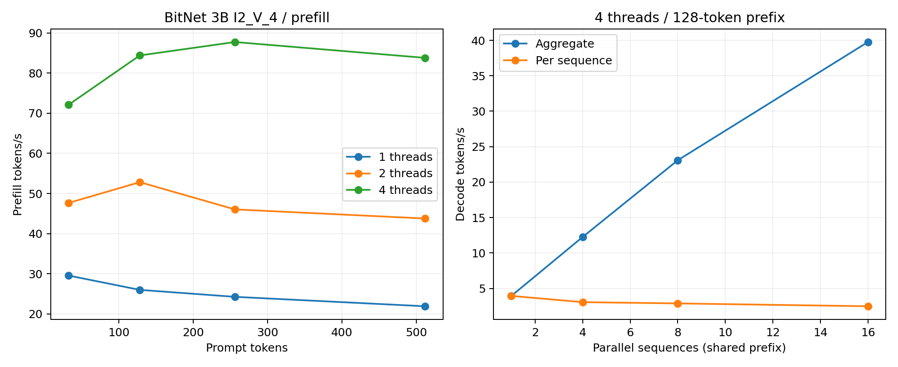

# P3 扩展：BitNet 3B I2_V_4

2026-11-17。**已完成真实推理、张量/调用路径检查及 18 配置、90 样本性能测试。** 不运行外部框架对比；不把 Falcon3 的结果直接推广到此模型。

## 固定条件与入口

- 模型：`XXXXyu/bitnet_b1_58-3B-vlut-gguf`，revision `9758ca86f6411ea903399e45537d6fa651243524`，唯一 I2 文件 `ggml-model-I2_V_4.gguf`，916,849,184 字节。
- SHA256：`8f9dd970b58c70180bffcf6bdbe0666b083913675d457a50decbf3cef8ec3d7e`。模型仓库卡声明 MIT；[模型来源](https://huggingface.co/XXXXyu/bitnet_b1_58-3B-vlut-gguf/tree/9758ca86f6411ea903399e45537d6fa651243524)。权重未提交 GitHub。
- 正式测量代码：`7073ce60`；运行 `p3-20261117-224457-423`。启动时跟踪源码无差异，状态中记录了尚未编译的 P4 测试文件。图表分析随后增加模型名称选择，未改变计时样本。
- i7-12700H / WSL Ubuntu 24.04，CPU-only，GCC 13.3，Release，tile=32、unroll=16，AVX512/SVE/Accelerate/BLAS/GPU 均关闭。与 Falcon3 使用相同 CPU places、线程、P/G/B、预热与五次重复定义；详细计时边界沿用 [P3_METHOD.md](P3_METHOD.md)。
- Linux：`VECLUT_REPRO_DIR=/mnt/e/VecLUT-Repro bash reproduction/run-p3.sh --model bitnet-3b-i2v4`。Windows 本机：`E:\VecLUT-Repro\scripts\run-p3.ps1 -Model bitnet-3b-i2v4`。公共 PowerShell 入口同样支持 `-Model` 和 `-DataDirectory`。

## 功能与真实矩阵

这是 base 模型，未伪造聊天模板。功能提示为 `Paris is the capital of France. The city is known for`，实际续写包含 `its rich history, beautiful architecture, and world-class museums`。这只是功能检查，不是准确率评估。

GGUF 实际含 **182 个 I2_V_4、287 个 F32、1 个 Q8_0 张量**。26 层，每层 7 个目标矩阵：

| M×K（输出×输入） | 张量数 | 对应层 |
|---|---:|---|
| 3200×3200 | 104 | Q、K、V、attention output |
| 8640×3200 | 52 | FFN gate、up |
| 3200×8640 | 26 | FFN down |

这里列的是权重 M×K，不表示所有 Prefill 调用的 N 都等于输入长度。作者 `build_bitnet` 在末层用 `ggml_get_rows` 只保留需要输出的位置，随后 FFN 的 token 数会缩小；计数仍是在真实调用入口采集。

实际入口计数：4 线程一次 Prefill 为 **728=182×4** 次；48 步功能生成为 **34,944=182×4×48** 次。B=1/4 的 normal/profile 分别逐 token 一致，logits 有限；计数发生在真实 `ggml_gemm_i2v4_i8v_lut` 内，不由模型大小推算代替。

**跨批量/跨序列的文本不完全一致。** 首轮因此被拦下，随后定位到浮点微差跨越 INT8 舍入阈值。182 个矩阵的独立 INT64 抽样误差为零。详见 [数值审查](BITNET_NUMERICAL_AUDIT.md)，原始失败日志保留。不能把有限 logits 或一段连贯文字等同于质量无损。

## 性能结果

全部配置 CV≤3.79%；计时区间 major faults=0，监控 swap in/out=0。最大进程 RSS **1768.3 MiB**，最低系统可用内存约 **9.99 GiB**；RSS 不是整机最低内存要求。

| 阶段 | 条件 | 中位吞吐 tokens/s |
|---|---|---:|
| Prefill | P=32，4 线程 | 72.08 |
| Prefill | P=128，4 线程 | 84.38 |
| Prefill | P=256，4 线程 | 87.72 |
| Prefill | P=512，4 线程 | 83.78 |
| Decode | P=128，G=32，B=1，1/2/4 线程 | 1.73 / 2.75 / 3.94 |
| Decode | 相同 P/G，4 线程，B=4 | 合计 12.26；每序列 3.06 |
| Decode | 相同 P/G，4 线程，B=8 | 合计 23.08；每序列 2.89 |
| Decode | 相同 P/G，4 线程，B=16 | 合计 39.76；每序列 2.49 |

表中 Decode 包含每步模型前向、主机 batch 更新和全词表有限值/贪心扫描；加载单独记录。并行序列共享同一提示前缀，性能模式固定生成步数且忽略 EOS，因此合计吞吐不能称为单请求速度，也不代表不同提示的在线服务。

在本机，BitNet 从 1 到 4 线程的单路 Decode 约加速 2.28 倍；增大 B 提升合计吞吐、降低每序列速度。Prefill 并非随 P 单调变快，P=256→512 从 87.72 降至 83.78，保留这一结果。相较 Falcon3 更大模型速度较低是观察，不构成两模型公平算法比较或性能退化归因。

## 证据与边界

- [完整表格](evidence/p3-bitnet/performance/measurements/measurements.md)、[原始 CSV](evidence/p3-bitnet/performance/measurements/raw.csv)、[调用核验](evidence/p3-bitnet/performance/measurements/path-verification.json)、[质量检查](evidence/p3-bitnet/performance/measurements/quality.json)。
- `evidence/p3-bitnet/stopped/` 保留首次停止；`audit/` 保留节点/生成日志和 logits 差异摘要。二进制 logits 仅保留 E 盘，不放公开仓库。
- [文件哈希](evidence/p3-bitnet/evidence.sha256) 覆盖发布证据。图表与数值独立于后续 I1/微优化。
- 未测试标准质量、长上下文、服务器、硬件性能计数；没有证明各 token 批量下的数值不变性，也没有复现论文的跨框架加速比。
