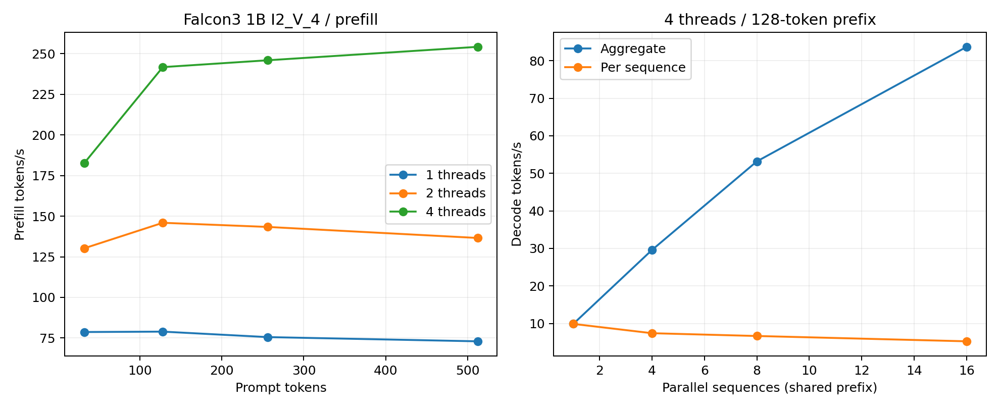

# P3：Falcon3 1B I2_V_4 实测报告

本轮完成用户指定的 Falcon3 1B 真实推理、I2_V_4 路径验证及本系统 Prefill/Decode。未实施优化方案，未运行其他框架。原总路线的 BitNet 3B 扩展保留为后续项，未下载。

正式证据：`p3-20261117-220123-426`；测试代码 `3da36b69b2eb523bc91b0241d5376dbd927d783c`。运行与依赖见 [P3_METHOD.md](P3_METHOD.md)，[原始公开证据](evidence/p3)。

## 1. 模型、环境与真实性

模型：[原作者指定 Falcon3 GGUF](https://huggingface.co/XXXXyu/Falcon3-1B-Instruct-1.58bit-vlut-gguf/blob/1cf5c2dc924ab7117053758da68f8376da95fc4d/ggml-model-I2_V_4.gguf)；固定 revision `1cf5c2dc924ab7117053758da68f8376da95fc4d`，文件 `ggml-model-I2_V_4.gguf`，659,366,272 字节；SHA256 `6eb67473189b8b6d1a02cdc723b2f284b0e247eba27619c46117fd2d592c6b94`。下载后及正式运行前均校验。首次网络超时已从 .part 重试成功，下载日志保留；没有下载其他格式或整个模型仓库。

本机 i7-12700H / WSL2 Ubuntu 24.04，复用现有 GCC/G++、CMake、Python3。CPU Release/native，tile=32、weight unroll=16、K 累加块=128；OpenMP 固定虚拟 CPU places `{0},{2},{4},{6}`，不推断宿主 P/E 核。GPU offload=0、F16 KV、Flash Attention OFF。

GGUF 逐张量统计：126 个 I2_V_4、163 个 F32、1 个 Q4_K、1 个 Q6_K。18 层，每层 7 个 I2_V_4 矩阵；嵌入/输出等仍使用其他类型。因此这是作者的 I2_V_4 混合模型，不是所有张量都以两位编码。

## 2. 真实生成与内核调用

使用模型自带 chat template，输入 “What is the capital of France? Answer in one short sentence.”；单序列和四序列均生成：

> The capital of France is Paris.

贪心生成 7 个 token 后遇到 EOG。检查 logits 全部有限、生成非空；normal/profile 全部 token IDs 相同。另核对四序列的每条结果都与单序列相同。它证明该例功能与批处理一致，不是模型质量或精度评测。

| 诊断批次 | 线程 | Prefill 内核工作线程调用 | Decode 步数 | Decode 内核工作线程调用 |
|---|---:|---:|---:|---:|
| B=1 | 4 | 504 | 7 | 3528 |
| B=4 | 4 | 504 | 7 | 3528 |

计数来自实际 `ggml_gemm_i2v4_i8v_lut` 函数入口，不是模型名称。每次前向 126×4=504 次工作线程调用；7 步为 3528 次。调用链为 `llama_decode → 模型计算图 → ggml_compute_forward_mul_mat → I2_V_4 类型分发 → ggml_gemm_i2v4_i8v_lut`。

功能诊断构建开启 P2 的计数器；以下正式性能全部来自关闭插桩的 normal 构建。没有把 profile 开销计入性能结论。

## 3. Prefill

使用精确长度的固定英文 token 序列，预热 1 次后重复 5 次。计时为实际模型 decode+synchronize，排除下载、加载、tokenization 和文本输出。单位为整模型处理的输入 tokens/s，已不是 P2 的单算子 runs/s。

| 输入 token | 线程 | 中位时延 ms | tokens/s | CV |
|---|---:|---:|---:|---:|
| 32 | 1 | 406.68 | 78.69 | 2.1% |
| 32 | 2 | 245.77 | 130.20 | 0.9% |
| 32 | 4 | 175.27 | 182.57 | 4.3% |
| 128 | 1 | 1621.73 | 78.93 | 1.2% |
| 128 | 2 | 877.15 | 145.93 | 0.5% |
| 128 | 4 | 529.46 | 241.76 | 1.7% |
| 256 | 1 | 3388.10 | 75.56 | 1.6% |
| 256 | 2 | 1785.51 | 143.38 | 0.7% |
| 256 | 4 | 1040.79 | 245.97 | 2.0% |
| 512 | 1 | 7016.73 | 72.97 | 0.9% |
| 512 | 2 | 3748.57 | 136.59 | 0.3% |
| 512 | 4 | 2013.86 | 254.24 | 0.9% |

## 4. Decode

固定 128-token 共享前缀，每条序列执行 32 个自回归 decode 步骤；性能模式不因 EOG 提前停止。下表主要计时含模型前向、下一批 token 构造、贪心及有限值扫描；模型调用单独耗时同时保存在 CSV。每次重复都重新 Prefill，Prefill 不计入 Decode。

| 并行序列 B | 线程 | 32 步中位时间 ms | 合计 tokens/s | 每序列 tokens/s | CV |
|---:|---:|---:|---:|---:|---:|
| 1 | 1 | 7337.59 | 4.36 | 4.36 | 1.8% |
| 1 | 2 | 4046.04 | 7.91 | 7.91 | 0.7% |
| 1 | 4 | 3242.51 | 9.87 | 9.87 | 1.6% |
| 4 | 4 | 4328.83 | 29.57 | 7.39 | 1.7% |
| 8 | 4 | 4813.59 | 53.18 | 6.65 | 3.1% |
| 16 | 4 | 6116.38 | 83.71 | 5.23 | 1.8% |

B>1 的合计 throughput 为 B×32/秒，每序列为 32/秒。它们共享同一前缀且使用确定性生成，不能当成独立异长请求的服务压测；合计吞吐上升也不表示单请求变快。

## 5. 资源、加载与测量质量

正式 18 配置、90 样本；CV>10% 为 0 组，稳态计时重复 major faults=0。WSL swap in/out=0/0 页，最低可用内存 10.64 GiB。

最大进程 RSS 893.1 MiB，包含映射模型、KV、计算图和工作区，并非独占物理内存。模型文件大小约 628.82 MiB，不能用文件大小代替运行 RSS。

各配置单独加载模型：加载调用中位 3833.69 ms，范围 2958.69–7859.68 ms；上下文创建中位 34.46 ms。这是 mmap 和已有文件缓存条件下的记录，不是受控冷盘启动；加载与上下文初始化均没有计入上面的吞吐。

每案例 warmup、5 个原始样本、命令、完整 stderr 和资源监控均保留。公开材料含原始 JSONL/CSV、模型 hash、图表与调用计数；GGUF 权重不上传 GitHub。

## 6. 边界和运行中的提示

- 日志保留了 `file type = unknown, may not work`：源码格式名称 switch 未列出所有 Vec-LUT 格式；本次通过逐张量 GGUF 类型、真实执行、有限 logits 和实际内核计数验证路径，没有靠这个汇总名称判断类型。
- 日志中的 CPU_AARCH64 preferred buffer 选择回退到 CPU；本次 GPU offload=0，实际使用 x86 CPU 路径。没有为消除提示修改作者分配策略。
- /mnt/e 的文件时钟偏移警告保留，构建完成且实际模型运行通过；没有修改系统时钟。
- 只有上述固定模型和测试范围的功能/性能证据。未测语言模型困惑度、标准质量集、长上下文、服务延迟分位数或能耗；没有优化收益。
- 后续沿原路线补充 P3 的 BitNet 3B 扩展，再进入 P4 I1。分块提升转置方案仍留待 P5/P6，不在本轮实现。

## 7. GitHub 仓库说明

仓库已创建：[WMASTER123/VecLUT-Repro](https://github.com/WMASTER123/VecLUT-Repro)，是 OpenBitSys/vlut.cpp 的公开 Fork，默认开发分支为 `repro/cpu`。复现材料在 reproduction/，作者 master 保留。若仓库列表仅筛选 Sources，可切换 All/Forks；主页是否展示也取决于固定的仓库列表，直接链接可访问。
