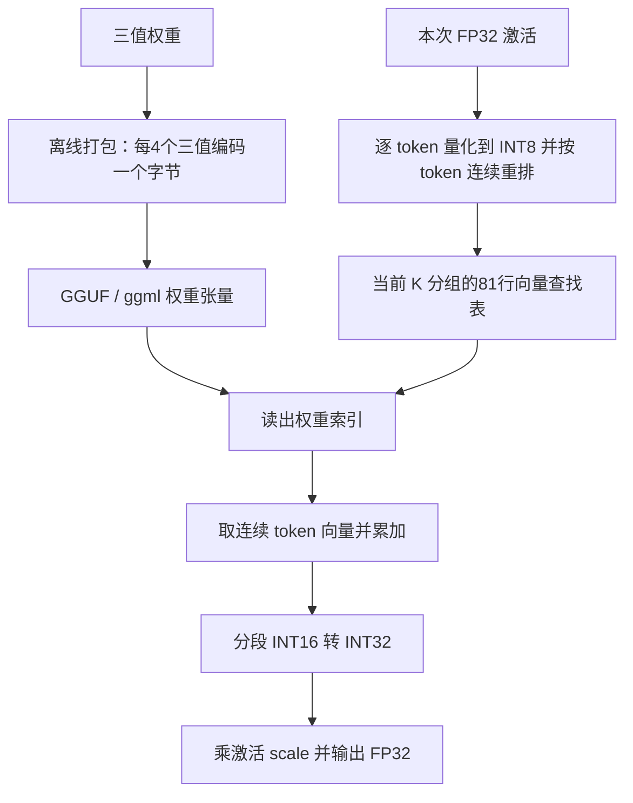

# 核心机制：代码、验证和修复如何对应

本文基于作者提交 `7a813d9c` 和本仓库 `repro/cpu` 分支。论文：[Vec-LUT v2 §3–4](https://arxiv.org/html/2512.06443v2)。具体反例见 [P1_REPORT.md](P1_REPORT.md)。

## 数据流



数学上计算 `W[M,K] × A[K,N] → O[M,N]`。W 是三值权重，N 是同时处理的 token 数。向量 LUT 的目的，是让同一权重组合对多个 token 的预计算结果连续排列。原本逐 token 的查表变为一次定位后读取连续向量，不表示只读一个数，也不表示任意 N 都对应单条机器指令。

## 1. 权重打包：长期保存的索引

代码：[ggml-quants-vlut.c](../ggml/src/ggml-quants-vlut.c)，`quantize_i2_v_4`。

将 `-1/0/+1` 映射到 `0/1/2`，索引 `idx=d0+3*d1+9*d2+27*d3`。81 种组合装进一个字节。`[-1,+1,0,+1]` 的索引是 69，全零组合为 40。

`I2_V_4` 的 `_4` 是四个打包字节的分块布局，一次覆盖 16 个 K 元素，不是 4 bit 权重。按输出行与四个 K 分组重排，使查询循环读取四个相邻索引。该格式要求 K 是 16 的倍数；修复版显式拒绝不完整权重 tile，避免丢掉 K 尾部或写越界。

P1 使用真实打包函数，覆盖全部 81 种组合，并用独立的三进制解码检查每个权重；也让全部 81 种组合进入实际内核。

## 2. 激活变换：本次请求的临时数据

代码：[ggml-cpu-quants-vlut.c](../ggml/src/ggml-cpu/ggml-cpu-quants-vlut.c)，`quantize_row_i8_v_tile`。

每个 token 计算一份 scale；修复版采用绝对值最大值进行对称量化，Q 在 [-127,127] 内，全零输入单独返回零。极小 scale 最低取 FP32 正常数下界，避免除以 0；这种极端浮点范围下按实际步长定义误差界限。

激活布局是 `[token_tile][K][token_in_tile]`，地址为：

```text
tile_id*K*32 + k*32 + token_in_tile
```

一个 token 的 K 个特征间隔 32 个字节，不同 token 填不同列。作者框架的写入地址漏掉 tile 步长中的 K，因此前 32 个 token 正常、第二块开始交叠。修复后还初始化无效 token 列，避免整宽建表读取未初始化数据。

量化误差与内核错误分开：量化检查按步长给出重建误差上界；内核比较使用同一 INT8 激活，要求整数结果精确一致。

## 3. 建表与查询：激活决定表，权重决定行

代码：同文件的 `gemm_make_table_i2v`、`MAKE_TABLES_I2S_BLOCK4`、`ADD_TABLE_ENTRIES_BLOCK4`。

表的每行对应一种四元组权重组合，每列对应一个 token。建表通过加法和取反复用中间表项；同一表对不同输出行复用，但换了激活或 K 分组就必须重建。

手算第一组：两个 token 的激活四行分别是 `[2,1]、[3,-2]、[-1,4]、[4,3]`。查索引 69 得到 `-[2,1]+[3,-2]+[4,3]=[5,0]`。测试再加第二个 K 分组，实际内核输出 `[4,-3]`，与手算完全一致。

## 4. 缓存分块与累加范围

代码：`ggml_gemm_i2v4_i8v_lut`。

默认 token tile=32，一次建立四张 `81×32` 的 INT16 表，总计 20,736 字节。这个值仅指 LUT，不包括激活和累加器，因此不能说整个工作集一定驻留 L1。

循环顺序是 token tile → 累加段 → 四张表及查询输出行 → INT16 转 INT32。作者累加段 K=512，最大绝对值可达 `512×128=65536`，超出 INT16。转 INT32 已经太晚。

修复版段长为 128，最坏绝对值 `128×128=16384`，在 INT16 范围内；该长度也是 16 的倍数，不破坏权重 tile。累加后的 INT32 又有 K 上界检查。更频繁的提升/清零可能影响速度，P2 要测，这不是“免费加速”或微创新。

注意区分：三值组 g=4、一次查表 K tile=16、累加段 K=128、token tile N=32，四者用途不同。

## 5. 框架与线程

代码：[ggml-cpu.c](../ggml/src/ggml-cpu/ggml-cpu.c)，`type_traits_vlut`、`ggml_compute_forward_mul_mat`、`ggml_graph_plan`。

类型表选择内核。各线程分配不同 token 列做激活变换，屏障后按 M 输出行分配计算，不同线程写不同输出。各线程的内核会各自建表，重复建表是否是性能瓶颈尚未测量。

修复后工作区按 `ceil(N/32)*32*K + N*sizeof(float)` 规划；逐切片复用，并在复用前同步，输出写入相应切片。不再用固定最大 K/token 数猜测额外内存。

图测试覆盖 1/2/4 线程和不整齐的 M，验证跨 token tile 与切片的真实生产调用链。P1 不证明真实模型端到端推理已经通过，也没有证明所有 I1/I2 格式正确。

## 6. 后续边界

作者代码仍令 N=1 走 LUT，没有完成 GeMV fallback。工作区复用、短 token 专用路径属于后续候选；应先测瓶颈，不能把正确性修复包装成性能创新。

P2 只测本系统；I1 格式和其他 I2 分块变体另行验证；P3 才下载指定模型并检查真实执行路径。
